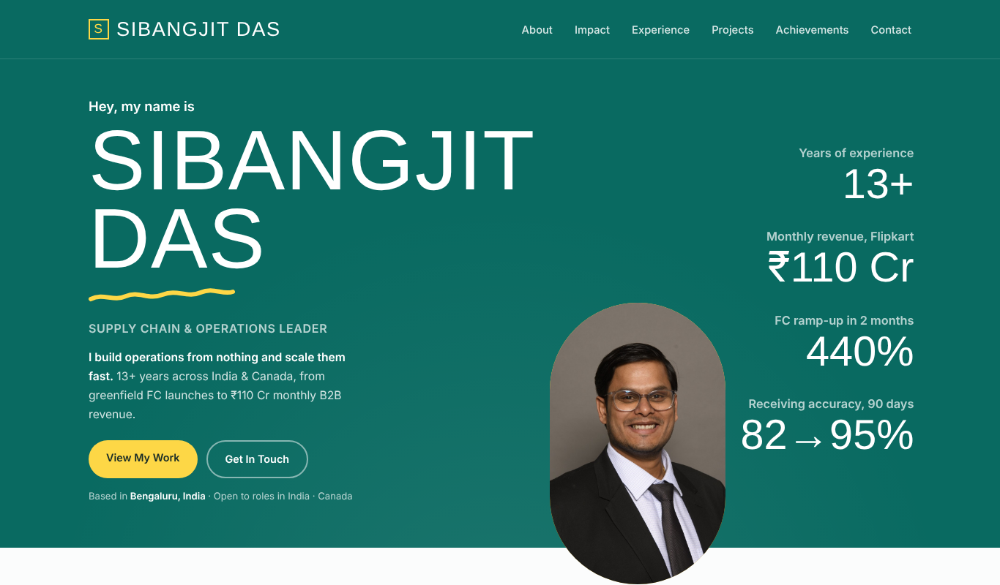
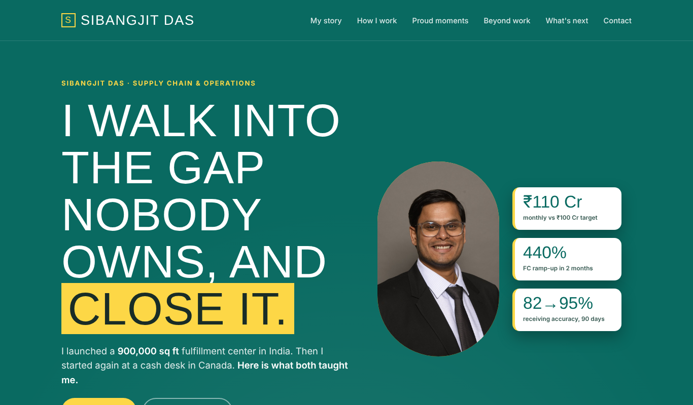
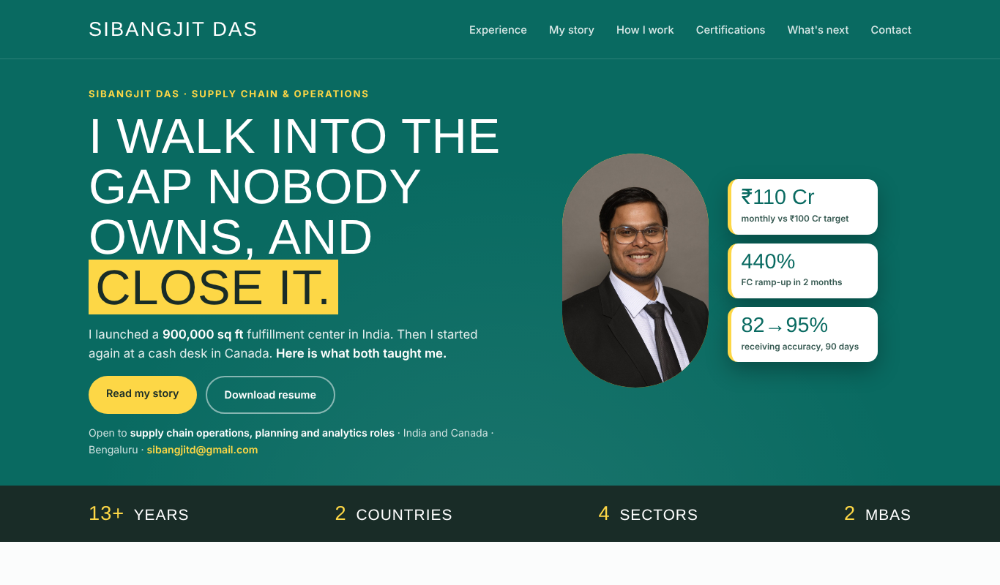
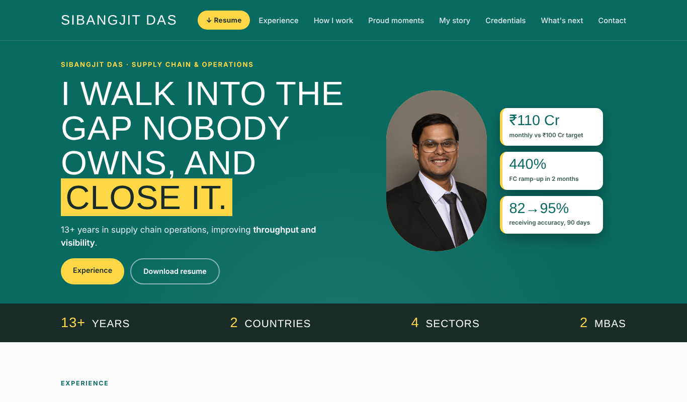
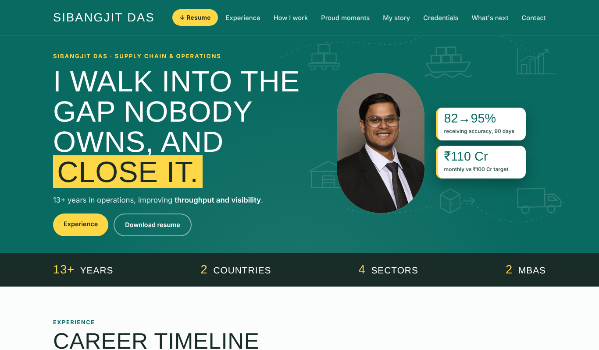
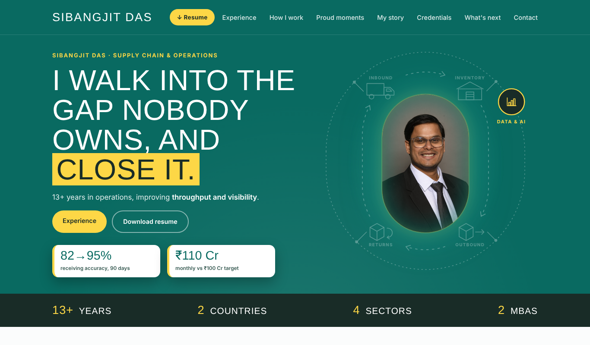

# AI-built portfolio site: 54 versions, one story

How I turned my personal site ([sibangjitdas.com](https://sibangjitdas.com)) from a resume page into a storytelling page for recruiters in India and Canada, by directing Claude (Anthropic's AI) round by round, mostly by voice.

**Compare the first and the final:** [v1](https://sibangjitd.github.io/ai-built-portfolio-site/versions/v1-redesign-live.html) | [v54 (live)](https://sibangjitd.github.io/ai-built-portfolio-site/versions/v54-flipkart-tags.html)

## The goal

One idea: *"I walk into the gap nobody owns, and close it."* A recruiter should get who I am in 10 seconds and my career in a scroll, not a wall of bullet points.

## How I worked

- **I directed, the AI built.** I gave direction by voice, usually one change at a time. Claude generated the page with Python scripts and checked it in a real browser at laptop and phone widths.
- **Every round is a new file.** Nothing was overwritten, so all 54 versions are in [`versions/`](versions/). That is the progress record.
- **Hard rules I set:** never invent metrics or experience, keep earlier versions untouched, consult me on phrasing before rewriting, and don't publish until I say so.
- **I made the judgment calls.** Examples: I rejected "Need someone who gets it done?" because it read as a doer, not a leader, and I refused to promise "analytics roles" before I was ready, so the copy says "planning".

## Timeline

| Stage | Versions | What changed |
|---|---|---|
| Start | v1 | Redesigned resume-style site |
| Story first | v2 - v14 | Punchy hero, clean cards, career chapters, certifications |
| Structure | v15 - v25 | Fixed header, "How I work", career timeline chart, compact layout |
| Copy and skills | v26 - v40 | One locked sentence and three skill tags per role, section order, headings, role list |
| Hero diagram | v41 - v49 | Animated supply chain loop around my photo: Inbound, Inventory, Outbound, Returns, with a Data & AI ring |
| Final polish | v50 - v54 | Closing line, working Email and Contact buttons, skill tag order |

## Screenshots (laptop width)

| v1 | v14 | v23 |
|---|---|---|
|  |  |  |

| v29 | v41 | v49 | v54 |
|---|---|---|---|
|  |  |  |  |

## What I learned

- Small, one-change rounds beat big rewrites: every decision stayed reviewable.
- Voice is fast for direction, but anything that needs exact wording or a file check is better done in text.
- The AI will happily generate impressive-sounding copy. My job was to keep it true.

## Viewing the versions

The HTML files open as live pages through GitHub Pages. Each is a single self-contained file.

### All versions

- [v1-redesign-live](https://sibangjitd.github.io/ai-built-portfolio-site/versions/v1-redesign-live.html)
- [v2-story](https://sibangjitd.github.io/ai-built-portfolio-site/versions/v2-story.html)
- [v3-punchy-hero](https://sibangjitd.github.io/ai-built-portfolio-site/versions/v3-punchy-hero.html)
- [v4-clean-cards](https://sibangjitd.github.io/ai-built-portfolio-site/versions/v4-clean-cards.html)
- [v5-two-mbas](https://sibangjitd.github.io/ai-built-portfolio-site/versions/v5-two-mbas.html)
- [v6-daily-huddles](https://sibangjitd.github.io/ai-built-portfolio-site/versions/v6-daily-huddles.html)
- [v7-cash-desk-scene](https://sibangjitd.github.io/ai-built-portfolio-site/versions/v7-cash-desk-scene.html)
- [v8-diverse-teams](https://sibangjitd.github.io/ai-built-portfolio-site/versions/v8-diverse-teams.html)
- [v9-fresher-learning](https://sibangjitd.github.io/ai-built-portfolio-site/versions/v9-fresher-learning.html)
- [v10-data-integration](https://sibangjitd.github.io/ai-built-portfolio-site/versions/v10-data-integration.html)
- [v11-data-wording](https://sibangjitd.github.io/ai-built-portfolio-site/versions/v11-data-wording.html)
- [v12-hobbies](https://sibangjitd.github.io/ai-built-portfolio-site/versions/v12-hobbies.html)
- [v13-hobbies-timing](https://sibangjitd.github.io/ai-built-portfolio-site/versions/v13-hobbies-timing.html)
- [v14-certifications](https://sibangjitd.github.io/ai-built-portfolio-site/versions/v14-certifications.html)
- [v15-fixed-header](https://sibangjitd.github.io/ai-built-portfolio-site/versions/v15-fixed-header.html)
- [v16-how-i-work](https://sibangjitd.github.io/ai-built-portfolio-site/versions/v16-how-i-work.html)
- [v17-consult-decide-own](https://sibangjitd.github.io/ai-built-portfolio-site/versions/v17-consult-decide-own.html)
- [v18-show-the-benefit](https://sibangjitd.github.io/ai-built-portfolio-site/versions/v18-show-the-benefit.html)
- [v19-plan-whats-next](https://sibangjitd.github.io/ai-built-portfolio-site/versions/v19-plan-whats-next.html)
- [v20-hobbies-short](https://sibangjitd.github.io/ai-built-portfolio-site/versions/v20-hobbies-short.html)
- [v21-compact](https://sibangjitd.github.io/ai-built-portfolio-site/versions/v21-compact.html)
- [v22-planning-analytics](https://sibangjitd.github.io/ai-built-portfolio-site/versions/v22-planning-analytics.html)
- [v23-career-timeline](https://sibangjitd.github.io/ai-built-portfolio-site/versions/v23-career-timeline.html)
- [v24-education-moved](https://sibangjitd.github.io/ai-built-portfolio-site/versions/v24-education-moved.html)
- [v25-one-line-achievements](https://sibangjitd.github.io/ai-built-portfolio-site/versions/v25-one-line-achievements.html)
- [v26-text-and-skills](https://sibangjitd.github.io/ai-built-portfolio-site/versions/v26-text-and-skills.html)
- [v27-tag-fixes](https://sibangjitd.github.io/ai-built-portfolio-site/versions/v27-tag-fixes.html)
- [v28-landing-and-resume](https://sibangjitd.github.io/ai-built-portfolio-site/versions/v28-landing-and-resume.html)
- [v29-hero-hook](https://sibangjitd.github.io/ai-built-portfolio-site/versions/v29-hero-hook.html)
- [v30-consistency-fixes](https://sibangjitd.github.io/ai-built-portfolio-site/versions/v30-consistency-fixes.html)
- [v31-open-to-label](https://sibangjitd.github.io/ai-built-portfolio-site/versions/v31-open-to-label.html)
- [v32-two-stat-cards](https://sibangjitd.github.io/ai-built-portfolio-site/versions/v32-two-stat-cards.html)
- [v33-offclock-moved](https://sibangjitd.github.io/ai-built-portfolio-site/versions/v33-offclock-moved.html)
- [v34-offclock-in-contact](https://sibangjitd.github.io/ai-built-portfolio-site/versions/v34-offclock-in-contact.html)
- [v35-offclock-after-next](https://sibangjitd.github.io/ai-built-portfolio-site/versions/v35-offclock-after-next.html)
- [v36-matching-pills](https://sibangjitd.github.io/ai-built-portfolio-site/versions/v36-matching-pills.html)
- [v37-hobbies-heading](https://sibangjitd.github.io/ai-built-portfolio-site/versions/v37-hobbies-heading.html)
- [v38-heading-scale](https://sibangjitd.github.io/ai-built-portfolio-site/versions/v38-heading-scale.html)
- [v39-no-open-pills](https://sibangjitd.github.io/ai-built-portfolio-site/versions/v39-no-open-pills.html)
- [v40-roles-and-direction](https://sibangjitd.github.io/ai-built-portfolio-site/versions/v40-roles-and-direction.html)
- [v41-hero-flow-icons](https://sibangjitd.github.io/ai-built-portfolio-site/versions/v41-hero-flow-icons.html)
- [v42-ops-loop](https://sibangjitd.github.io/ai-built-portfolio-site/versions/v42-ops-loop.html)
- [v43-hero-layout](https://sibangjitd.github.io/ai-built-portfolio-site/versions/v43-hero-layout.html)
- [v44-stadium-loop](https://sibangjitd.github.io/ai-built-portfolio-site/versions/v44-stadium-loop.html)
- [v45-data-ring](https://sibangjitd.github.io/ai-built-portfolio-site/versions/v45-data-ring.html)
- [v46-halo](https://sibangjitd.github.io/ai-built-portfolio-site/versions/v46-halo.html)
- [v47-even-spokes](https://sibangjitd.github.io/ai-built-portfolio-site/versions/v47-even-spokes.html)
- [v48-clear-labels](https://sibangjitd.github.io/ai-built-portfolio-site/versions/v48-clear-labels.html)
- [v49-clear-arcs](https://sibangjitd.github.io/ai-built-portfolio-site/versions/v49-clear-arcs.html)
- [v50-closing-line](https://sibangjitd.github.io/ai-built-portfolio-site/versions/v50-closing-line.html)
- [v51-closing-size](https://sibangjitd.github.io/ai-built-portfolio-site/versions/v51-closing-size.html)
- [v52-contact-buttons](https://sibangjitd.github.io/ai-built-portfolio-site/versions/v52-contact-buttons.html)
- [v53-kamloops-tags](https://sibangjitd.github.io/ai-built-portfolio-site/versions/v53-kamloops-tags.html)
- [v54-flipkart-tags](https://sibangjitd.github.io/ai-built-portfolio-site/versions/v54-flipkart-tags.html)
